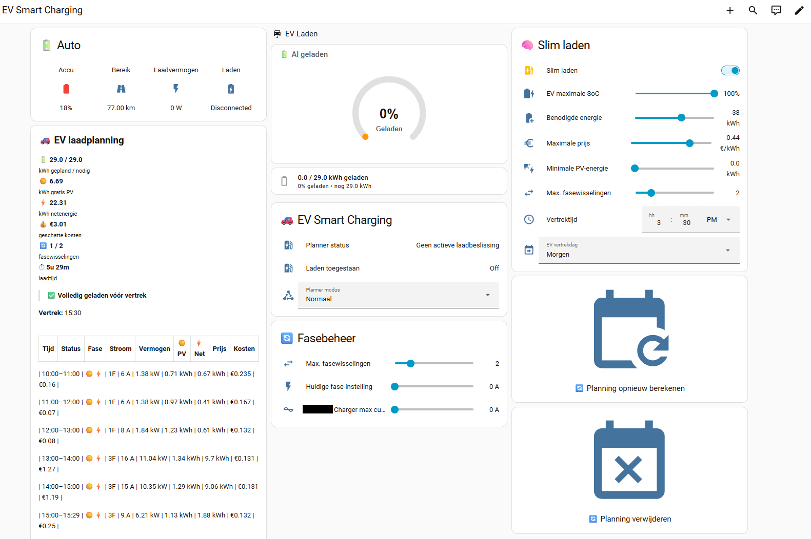

# EV Charge Planner

Native Home Assistant custom integration for EV charging planning using electricity prices and PV forecasts, with an optional built-in charge control.

**Current release line: 3.0.0**

## What's new in 3.0.0

Version 3.0.0 keeps the native entity model and the planner of 2.x and adds an optional **charge control** that can drive the charger itself, plus a more flexible way to describe how much energy you need.

Highlights:

- **Optional charge control** that brings the charger to the state the planner wants (allowed, phases, current) in the smallest safe steps. Disabled by default and shipped in dry-run mode, see [Charge control](#charge-control-optional);
- **Planned versus actual energy**: the delivered energy is compared with the plan after every charging block and while a block is running; the plan for the remaining energy is recalculated when you are behind or ahead of schedule;
- **Minimum and maximum energy**: the minimum is secured first, extra energy up to the maximum is only added from free PV or very cheap slots, see [Minimum and maximum energy](#minimum-and-maximum-energy);
- **Forecast prices** for hours whose final price is not known yet, with an adjustable markup, also used as a complete fallback when the price sensor is down, see [Prices not yet known](#prices-not-yet-known-for-tomorrow);
- **Maximum number of pauses** between charging blocks, so the charger does not switch on and off all the time;
- **Automatic re-plans keep the original departure date** (a re-plan you start yourself uses your current settings);
- new number entities for the maximum energy, the price limit for extra charging, the number of pauses, the forecast markup and the progress threshold;
- the planner itself remains a decision layer; without the charge control, Home Assistant automations translate planner outputs into physical charger control.

Carried over from 2.x: memory-safe and fast dynamic-programming planner (NumPy fast path with automatic fallback), native settings that restore after a restart, solar-only planning and PV-current rounding, Zonneplan quarter-hour prices, Solcast half-hourly and hourly forecasts distributed proportionally over price slots, negative prices, partial plans for infeasible targets, and compatibility fallbacks for the previous `input_*` helpers.

See `CHANGELOG.md` for details and upgrade notes.

## Dashboard

A dashboard can be built directly from the native planner entities. The example below shows the main planner settings, status and planning outputs in Home Assistant.



The dashboard is an example only. Entity IDs may differ between installations, so use the entities created by your own EV Charge Planner config entry.

## What it does

EV Charge Planner calculates **when and how much** an EV should charge before a configured departure time.

It combines:

- electricity price data (final prices, optionally completed with forecast prices);
- Solcast PV forecasts;
- the minimum (and optionally maximum) charging energy you need;
- a maximum grid-price limit in ct/kWh, and a separate limit for extra charging;
- a minimum usable PV-energy setting for solar-only planning;
- a configurable phase-switch budget and a limit on the number of pauses;
- the configured maximum charging power.

**By default EV Charge Planner does not control the physical charger.** The planner itself never switches a charger on/off, sets charging current or changes phases. Those actions remain Home Assistant automation responsibilities unless you configure the optional [charge control](#charge-control-optional), which is a separate component that is disabled until you switch it on.

## Installation

### HACS

Add this repository as a custom HACS repository with category **Integration**.

After installation, restart Home Assistant. The integration is available under:

**Settings → Devices & services → Add integration → EV Charge Planner**

### Manual

Copy `custom_components/ev_planner/` to `/config/custom_components/ev_planner/`, restart Home Assistant, and add **EV Charge Planner** from the integration UI.

## Configuration

EV Charge Planner uses a config flow and an options flow.

During initial configuration you select only the external data sources:

| Setting | Entity type |
|---|---|
| Electricity prices | `sensor` |
| Solcast today | `sensor` |
| Solcast tomorrow | `sensor` |

In the options you can additionally set an optional **forecast prices** sensor and the **charger** entities for the charge control (both described below).

The planner settings are provided as **native Home Assistant entities** by the integration. They are not required as existing `input_*` helpers during setup.

### Native planner settings

| Setting | Native entity | Default |
|---|---|---:|
| Departure time | `time.ev_charge_planner_departure_time` | 23:59 |
| Departure day | `select.ev_charge_planner_departure_day` | Vandaag |
| Minimum energy needed | `number.ev_charge_planner_energy_needed` | 10 kWh |
| Maximum energy needed | `number.ev_charge_planner_maximum_energy_needed` | 0 kWh (off) |
| Price limit extra charging | `number.ev_charge_planner_price_limit_extra_charging` | 5 ct/kWh |
| Maximum grid price | `number.ev_charge_planner_maximum_grid_price` | 0 ct/kWh |
| Minimum PV for solar-only | `number.ev_charge_planner_minimum_pv_for_solar_only` | 0 kWh |
| Maximum phase switches | `number.ev_charge_planner_maximum_phase_switches` | 8 |
| Maximum pauses | `number.ev_charge_planner_maximum_pauses` | 10 (no limit) |
| Maximum charging power | `number.ev_charge_planner_maximum_charging_power` | 11.04 kW |
| Forecast price markup | `number.ev_charge_planner_forecast_price_markup` | 2.0 ct/kWh |
| Charge progress threshold | `number.ev_charge_planner_charge_progress_threshold` | 0.5 kWh |
| Planner mode | `select.ev_charge_planner_planner_mode` | integration default |
| PV current rounding | `select.ev_charge_planner_pv_charging_current_rounding` | integration default |

Home Assistant may change entity IDs through the entity registry (the minimum energy entity keeps the id `number.ev_charge_planner_energy_needed` from earlier versions). Use the entity registry/UI when referencing these entities from automations.

The native entities restore their previous values after a restart. The departure time is a time-only entity; the separate departure-day entity determines whether that time applies to today or tomorrow. Existing installations can also use the previous `input_datetime`, `input_select` and `input_number` settings as compatibility fallbacks where applicable.

### Planner modes

**Normaal laden** uses the normal price/PV optimizer. It plans the required charging energy as cheaply as possible before departure. PV energy is treated as free, while grid charging is only used when the configured price limit permits it.

**Alleen zonneladen** uses only periods with usable PV production. The planner maximizes useful PV charging and does not create grid-only charging periods. The minimum-PV setting filters out small PV periods in this mode; it does not restrict normal price-based charging.

### PV-laadstroom afronden

In **Alleen zonneladen**, the planner derives a charging current from available PV power:

- **Naar beneden — geen netenergie** selects the highest valid current that does not exceed available PV power. If PV is below the minimum 6 A charging current, that period is not selected.
- **Naar boven — kleine netaanvulling toegestaan** selects the lowest valid current that reaches or exceeds available PV power. The difference is treated as paid grid energy for that period.

For example, with 2.1 kW available PV on 1 phase, rounding down selects 9 A (2.07 kW), while rounding up selects 10 A (2.30 kW).

The planner respects its electrical limits: 6–16 A integer current, 1-phase/3-phase operation, the configured maximum charging power, and the hard phase-switch safety cap.

### Minimum and maximum energy

The planner always secures the **minimum** (*Minimum energy needed*) first, at the usual maximum grid price. If you also set a **maximum** (*Maximum energy needed*, above the minimum; `0` = off), extra energy up to that maximum is added only from free PV or from slots at or below *Price limit extra charging* (negative prices count). Without such slots you simply get the minimum.

A typical use: set the minimum to what you need for tomorrow and the maximum to "battery full". Surplus solar power or very cheap hours then top up the battery, while the minimum is always guaranteed.

With the charge control, the planned-versus-actual checks and the progress check apply to the **minimum** only; extra charging is optional and never triggers corrections. Once the minimum is reached and nothing cheap is available, nothing more is planned and this is checked again every 5 minutes. When the maximum is reached (or when you call `clear_plan`) both numbers go back to 0 kWh. The plan attribute `extra_energy_kwh` shows how much of the plan is extra energy.

### Maximum pauses

The number entity *Maximum pauses* limits how often a plan may stop and start charging again. A pause is a gap between two charging periods; time before the first and after the last charging period does not count. `0` means one continuous charging block, `1` at most two blocks, and so on. The highest value (10) means no limit. Fewer pauses can cost a little more, and if the target cannot be reached within the limit the planner plans as much as possible. The plan attributes `pauses` and `max_pauses` show the result.

### Prices not yet known for tomorrow

Day-ahead prices are often published in the afternoon. A plan made before that only knows the hours up to the end of the known prices. The planner remembers how far the prices reached; when more prices appear and the plan did not yet cover the departure time, it re-plans automatically (checked at most every 5 minutes). The plan attributes `prices_valid_until` and `prices_cover_departure` show what the plan was based on.

### Forecast prices

In the options you can set an optional *Forecast prices* sensor (default `sensor.energy_price_forecast_eu_nl_current_retail_price`). It must provide records with `start`, `end` and `value` (EUR/kWh) in the attributes `raw_today`, `raw_tomorrow` and/or `raw_forecast`; these lists are combined and duplicates are removed.

- Only slots that directly follow the final prices are used, so real prices are never replaced by a forecast.
- A markup (*Forecast price markup*, default 2 ct/kWh) is added to forecast prices, never to final prices.
- If the final price sensor cannot be read at all (for example during an outage), the plan is built entirely from forecast prices, and refreshed automatically as soon as the real prices are back.
- Decisions based on a forecast carry `price_is_forecast: true`; the plan attributes `forecast_prices_used` and `forecast_price_slots` tell whether a forecast was used.
- Clear the field in the options to switch the feature off.

## Entities

The integration provides planner settings and outputs as native Home Assistant entities.

### Planner control and status

- **Smart charging switch**: enables/disables planner operation. It is not charger control.
- **State sensor**: reports the current planner state.
- **Data sensor**: exposes the complete current plan as state attributes.
- **Charging allowed binary sensor**: read-only indication that the current planner window permits charging.
- **Desired charge current sensor**: the current from the active planner decision in amperes (`0 A` when there is no active charging decision).
- **Desired phases sensor**: `1` or `3` for the active planner decision and `0` when there is no active charging decision.

The desired current, desired phase and charging-allowed entities are **planner outputs**. They do not change charger settings by themselves; your automations or the optional charge control translate them into charger control.

### Charge control entities

Available when the charger is configured: the sensors *Charge control* and *Energy deviation (last block)*, and the switches *Charge control active*, *Charge control dry-run* and *Charge control energy feedback*.

## Recommended architecture

```text
Home Assistant automation
        │
        ├── EV connected / planning trigger
        ├── update EV SOC / minimum (and maximum) energy
        └── ev_planner.create_plan
                    │
                    ▼
             ┌───────────────────┐
             │ EV Charge Planner │
             └─────────┬─────────┘
                       │
                planner outputs
                       │
        ┌──────────────┼────────────────┐
        ▼              ▼                ▼
    plan data     desired current  desired phase
        │              │                │
        └──────────────┼────────────────┘
                       ▼
        Charge control (optional, built in)
        or your own HA automation
                       │
             ┌─────────┴─────────┐
             ▼                   ▼
        charger on/off      current / phase
```

The planner is the decision layer. Either the optional charge control or your own Home Assistant automations form the physical charger control layer. Use only one of them at a time.

## Charge control (optional)

The charge control is a separate component inside the integration that brings your charger to the state the planner wants (charging allowed, number of phases, charging current). It replaces the typical "charging control" automation, and it also compares what the planner expected to charge with what was actually charged.

It is **only available when you configure the charger entities** in the integration options, and even then it does nothing until you switch it on.

### Configuration

Open the integration options and fill in the charger fields. All fields are optional, but the charge control needs at least the **mode sensor** and the **current number**.

The first time you open the options, the charger fields are pre-filled with suggested values (`sensor.ev_charger_status`, `number.ev_charger_max_current`, `switch.ev_charger_charging`, `button.ev_charger_stop_charging`, `number.ev_charger_phase_switch` with 32 = 1 phase and 0 = 3 phases, and `sensor.ev_charger_session_total_charge` for the energy sensor). **Check them and adjust them to your charger before saving.** Saving the form makes the charge control available, but it stays off (and in dry-run) until you switch it on.

| Option | Meaning |
|---|---|
| Charger mode sensor | Sensor with the charger state (for example `connected_charging`). |
| States for connected / charging / startable | Comma separated lists of mode values. Defaults: `connected_requesting,connected_charging,connected_finished` / `connected_charging` / `connected_requesting,connected_finished`. |
| Charging current number | Number entity that sets the maximum current (A). |
| Start/stop switch | Switch that starts charging. Without one, the charger is assumed to start by itself once a current is set. |
| Stop button or switch | Pressed or turned off to stop charging. Defaults to turning off the start switch. |
| Phase switch number | Number entity that switches between 1 and 3 phases. Leave empty if your charger cannot switch phases. |
| Phase values | Values of the phase number meaning 1 phase (default 32) and 3 phases (default 0). Any other value is treated as "unknown" and is never switched. |
| Charger energy sensor | Total or session energy (kWh or Wh). Enables the planned-versus-actual feedback. |

### Switches

| Switch | Default | Meaning |
|---|---|---|
| Charge control active | off | Master switch. Off means the charger is left completely alone. It also needs *Smart charging* to be on; with *Smart charging* off the charge control releases the charger. |
| Charge control dry-run | **on** | Only logs what would be done. Run it in dry-run for a few sessions before going live. |
| Charge control energy feedback | on | Planned-versus-actual correction (needs the energy sensor). |

If you currently use a charging control automation, **disable it before turning the charge control live**, otherwise the two will fight each other.

### How it works

The charge control always takes the smallest safe step and re-reads the planner after every step:

1. charging not allowed: stop, then set the current to 0;
2. wrong phase: stop first (never switch phases under load), then switch phase, then wait for confirmation;
3. wrong current: set the current;
4. everything matches and the charger waits for a start: start.

If the planner changes while a (slow) phase switch is running, the new plan is used immediately, and charging is never started with a phase that no longer matches the plan. Protections: a minimum time between phase switches (30 s), a start cooldown (120 s) with at most 3 start attempts (then it stops and notifies you; it tries again when the car is reconnected), and retry with back-off plus a persistent notification when a command is not confirmed. When the planner is unavailable, the charger is left as it is.

The charge control refreshes the planner itself every 30 seconds and additionally at every change in the plan (start or end of a charging block).

### Planned versus actual energy

A plan assumes ideal power. In reality a phase switch costs time, the car may limit the current, or the charger may start late. After **every charging block** (a run of consecutive planned slots) the cumulative planned energy is compared with the cumulative energy the charger actually delivered since the plan was made. If the difference is 0.3 kWh or more (in either direction), the plan is recalculated with the **actually remaining** energy.

- A *session* starts when the car is connected (or when you change the minimum energy value) and ends when the car is disconnected. The remaining energy is always `target - delivered during the session`; the energy settings themselves are not modified while the session runs.
- Meter resets (session meters that fall back to 0) are handled.
- Blocks during which the car was disconnected are not counted as a deviation.
- At most one automatic re-plan per 5 minutes. If a re-plan fails, the previous plan stays active.
- When the target is reached, planning stops ("Doel bereikt") and the energy numbers are set back to 0 kWh.
- Session and meter state survive a Home Assistant restart.

The same comparison also runs **while a block is charging**: after a 3-minute start-up period, a deviation of 0.5 kWh by default (adjustable with *Charge progress threshold*, 0.1–3 kWh; confirmed by two consecutive checks) triggers an immediate re-plan of the remaining energy, at most once every 5 minutes. The charger can then keep charging instead of stopping at the end of the planned block. The comparison is made at the time of the last meter reading, so a slow sensor does not count as a shortfall.

The result is visible in the *Energy deviation (last block)* sensor (actual minus planned, in kWh) and its attributes (target, delivered, remaining, number of re-plans).

> The energy sensor measures energy at the charger, while the energy value is whatever you entered. If you enter battery energy, expect charging losses (often 5–10 %) to show up as a persistent shortfall.

## Departure date on automatic re-plans

With departure day "Morgen" (tomorrow), an automatic re-plan on the day of departure (energy feedback, progress check, new prices) keeps the **original departure date** instead of moving it one day further. This holds as long as you did not change the departure time or day and the departure has not passed yet. A re-plan you start yourself (service `replan`/`create_plan` or a button) uses your current settings. The kept departure survives a Home Assistant restart.

## Services

### `ev_planner.update`

Runs one planner update cycle. The planner does not start its own periodic background loop; call this service from your own automation when appropriate. (When the optional charge control is configured, it refreshes the planner itself every 30 seconds.)

### `ev_planner.create_plan`

Creates a new charging plan from the current inputs.

For a single configured EV Charge Planner instance, `config_entry_id` is optional for backwards compatibility. When multiple instances are configured, specify the target `config_entry_id`.

### `ev_planner.replan`

Clears the current plan and creates a new one, using your current settings (including the departure day).

### `ev_planner.clear_plan`

Clears the current plan, ends the current charging session and sets *Minimum energy needed* and *Maximum energy needed* back to 0 kWh. If your automation calls `clear_plan` first, set the energy numbers **after** it.

### `ev_planner.status`

Returns the current runtime status and supports Home Assistant response data.

### `ev_planner.dashboard`

Returns current planner/dashboard data and supports Home Assistant response data.

## Planning behavior

The planner's objective is to schedule the required energy before departure while respecting the configured constraints.

- PV energy is treated as free.
- Grid charging is permitted only when the electricity price is within the configured maximum, except for the intentional small grid supplement allowed by PV rounding-up mode. Extra energy above the minimum is limited to free PV and slots at or below the extra-charging price limit.
- In normal mode, the minimum-PV setting is ignored.
- In solar-only mode, only usable PV periods are planned.
- The first active interval may start at the current time and the final active interval may end at departure.
- Intermediate active intervals preserve source-hour boundaries.
- Separate active charging blocks may have idle gaps, limited by *Maximum pauses*.
- Phase-switch counting is reset across idle/off windows.

## Electrical limits

The planner uses:

- 230 V;
- 6–16 A integer charging current;
- 1-phase and 3-phase charging;
- maximum 11.04 kW by default;
- configurable maximum charging power;
- configurable phase-switch budget with a hard safety cap of 8.

Typical reference powers are approximately:

- 1-phase 6 A: 1.38 kW;
- 1-phase 16 A: 3.68 kW;
- 3-phase 8 A: 5.52 kW;
- 3-phase 16 A: 11.04 kW.

## Planner output

The planning data sensor exposes the plan summary and individual decisions, including where available:

- required (minimum) energy;
- planned energy and extra energy above the minimum;
- missing energy;
- free PV energy;
- paid grid energy;
- estimated cost;
- completeness;
- departure time;
- maximum price;
- charging-window count;
- phase-switch count and pause count;
- price horizon and whether forecast prices were used;
- total charging minutes;
- individual charging decisions.

Individual decisions contain the source hour and the calculated charging settings, including charging current, number of phases, active charging interval and whether the price was a forecast.

## Zonneplan quarter-hour prices

The planner supports the current Zonneplan quarter-hour price format. Each price record can contain `start_date`, `end_date` and `price_tax_included.amount`. The amount is converted to €/kWh using Zonneplan's price representation.

Quarter-hour prices are treated as individual planning intervals. This means the planner can select some 15-minute periods within an hour while leaving other periods unused when their prices or planning conditions differ.

For backwards compatibility, the previous hourly Zonneplan format using `start_date` and `electricity_price` remains supported. The default price entity is `sensor.zonneplan_current_quarter_hourly_electricity_tariff`, but the electricity-price entity remains configurable in the integration setup.

When quarter-hour prices are combined with Solcast forecasts, the planner distributes each Solcast forecast interval over the overlapping price intervals. This preserves the original forecast energy instead of counting the same PV forecast multiple times.

### Negative prices and incomplete plans

Negative electricity prices are valid and are planned like any other price; they are the cheapest slots of the day.

If the required energy cannot be delivered (departure too close, too few slots at or below the maximum price, the phase-switch budget or the pause limit is too tight), the planner does **not** discard the plan. It schedules the maximum energy that is achievable and chooses the cheapest way to do so. The result is marked incomplete: `complete` is false and `missing_energy_kwh` shows how much could not be planned. Only when no slot can be used at all (for example every slot is above the maximum price) is the plan empty.

## Data sources

EV Charge Planner uses data supplied by other Home Assistant integrations. The recommended setup uses:

- **Solcast** for PV forecasts, supporting both half-hourly `detailedForecast` data and hourly `detailedHourly` data;
- an electricity-price integration such as **Zonneplan**, supporting both legacy hourly prices and the current quarter-hour price format;
- optionally a forecast-price sensor for hours whose final price is not published yet.

The integration does not hard-code those provider entities. You select the relevant Home Assistant sensors during configuration, so entity names can differ between installations.

## Troubleshooting

If the planner does not produce a plan:

1. Open **Settings → Devices & services → EV Charge Planner**.
2. Check the configured electricity-price and Solcast entities (and the optional forecast sensor).
3. Check the native planner settings and make sure the departure day/time and the minimum energy are valid. A minimum and maximum of 0 kWh means there is nothing to plan.
4. Check the planner state and planning-data entities for the reported reason.
5. If you use automations, verify that they call `ev_planner.create_plan` or `ev_planner.replan` at the intended time.

If the charge control does not act on the charger, check that *Smart charging* and *Charge control active* are on and *Charge control dry-run* is off, and look at the *Charge control* sensor and the log lines starting with "Laadregeling".

For issues or feature requests, use the repository issue tracker.

## Development

Run the test suite locally with:

```bash
python -m pytest -q
python -m ruff check .
```

GitHub Actions also validates pytest/Ruff, Home Assistant Hassfest and HACS integration validation on pushes and pull requests.

## License

This project is licensed under the MIT License. See `LICENSE` for details.
